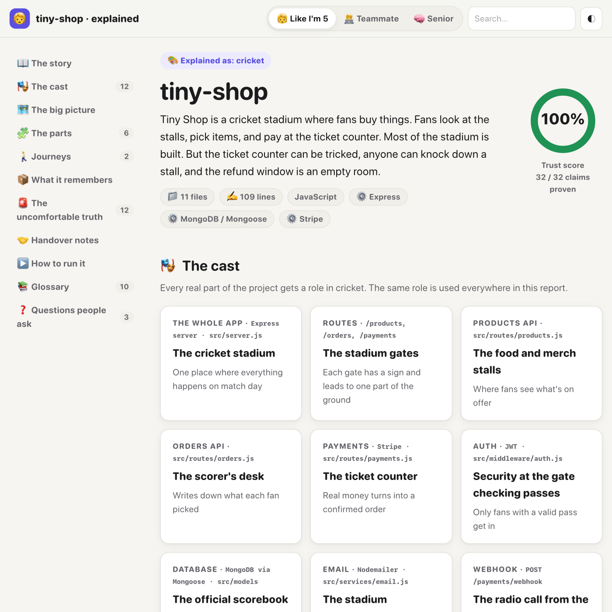
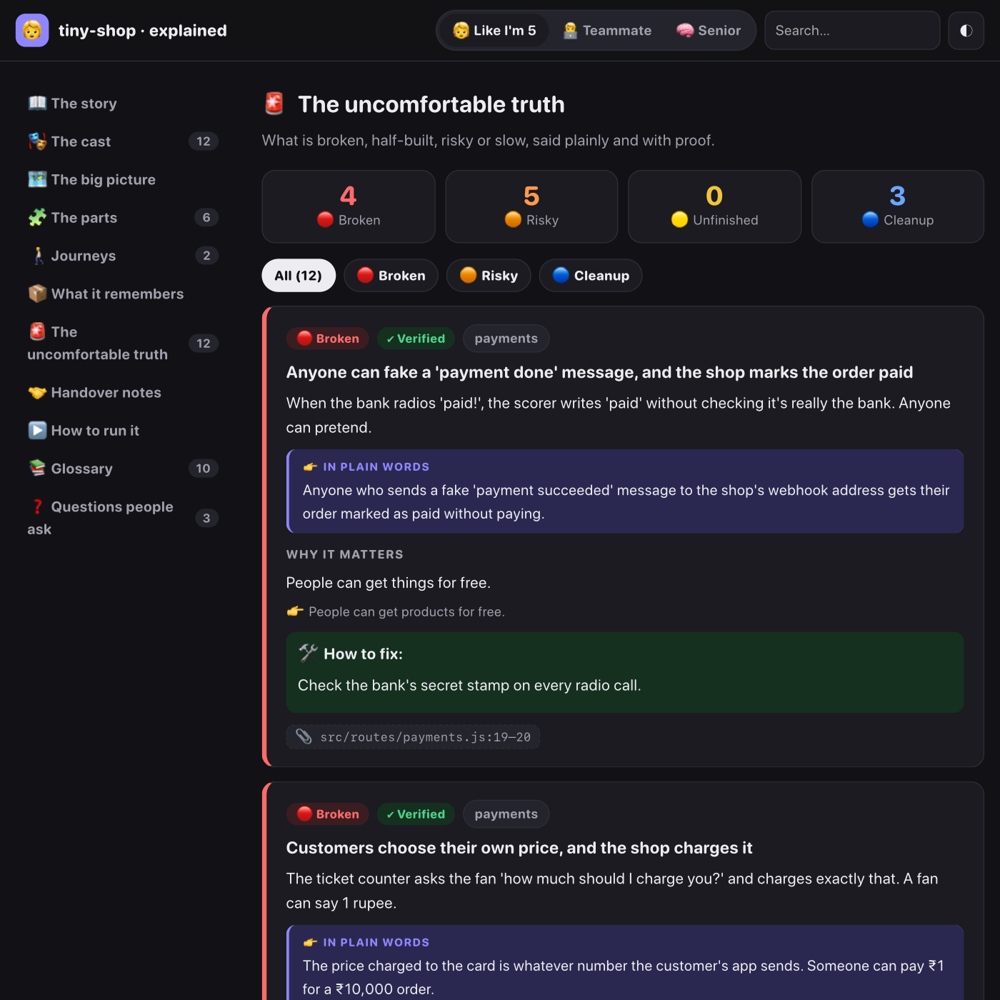
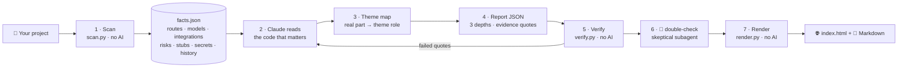

<div align="center">


# ELI5 Repo

### Any codebase, explained like you're 5, in a world you love.

**Cricket. Cars. Battle-royale games. Superhero movies. Cooking. Anything.**
Point it at a project and get the whole story: what every part does, how it all connects,
and *the uncomfortable truth* about what's broken, half-built or risky.
**Every claim comes with proof.**

> 🤖 *Claude Code and other AI tools can now build an entire project in days.*
> **ELI5 Repo makes sure you still know what's actually inside it.**

[](#-install)
[](#-how-it-works)
[](#-faq)
[](#-requirements)
[](LICENSE)

</div>

---

```text
/eli5:explain cricket
```

> 🏏 **Tiny Shop is a cricket stadium where fans buy things.** Fans look at the stalls, pick items,
> and pay at the ticket counter. Most of the stadium is built. But **the ticket counter can be tricked**,
> **anyone can knock down a stall**, and **the refund window is an empty room**.
>
> 🔴 *Anyone can shout "he paid!" on the radio and the scorer believes them* → [`payments.js:19`](fixtures/shop/src/routes/payments.js#L19)
> 🔴 *The fan decides the ticket price themselves* → [`payments.js:11`](fixtures/shop/src/routes/payments.js#L11)
> 🔴 *Anyone can knock down a stall without showing a pass* → [`products.js:10`](fixtures/shop/src/routes/products.js#L10)
>
> **Trust score: 100%**: 32 of 32 claims backed by real code.

<p align="center">
  
  
</p>

👉 **See the full example:** [examples/shop-cricket](examples/shop-cricket/) (open `index.html` in a browser, or read the [Markdown version](examples/shop-cricket/README.eli5.md)).

---

## 🤔 Why this exists

AI now writes most of the code. Big projects get built in days. Projects change hands halfway through.
**Nobody really knows what's going on inside until they dig through it by hand**, and that takes forever.

ELI5 Repo gives you that understanding in minutes, in a language you already love, without hiding the bad parts.

| You are… | You get… |
|---|---|
| 🧑‍💻 A developer handed someone else's half-finished project | What each part does, what was left mid-way, and what to fix first |
| 🧑‍💼 A founder or PM who "vibe-coded" an app with AI | A plain-language map of what you actually own, and where it's fragile |
| 🎓 A learner exploring open source | A story you can follow, then the real technical detail when you're ready |
| 🔍 A reviewer before launch | A health check that names broken payments, missing auth and slow queries, with proof |

## ✨ What makes it different

- 🎨 **Your theme, for the whole project.** Not one cute analogy, but a consistent cast: the database is *always* the scorebook and payments are *always* the ticket counter. 10 built-in theme packs, and any other topic works too.
- 🚨 **The uncomfortable truth.** A dedicated section for what's 🔴 broken, 🟠 risky, 🟡 unfinished or 🔵 needs cleanup: fake payment confirmations, unprotected delete routes, empty handlers, SQL injection, N+1 queries, swallowed errors, hardcoded secrets…
- 📎 **Proof for every claim.** Each statement links to an exact `file:line` with a quote. A checker that uses **no AI** opens every file, confirms every quote, fixes shifted line numbers, flags anything unproven, and shows a **Trust Score**.
- 🧒🧑‍💻🧠 **Three depths in one report.** Flip between *Like I'm 5*, *Teammate* and *Senior* with one click.
- 🤝 **Handover notes.** Reads the project's history (read-only) to show what the last person was in the middle of, what's uncommitted, and who knows which area.
- 🔒 **Local, free, read-only.** Runs inside Claude Code. The helper scripts are plain Python with **zero dependencies**. Your code never goes anywhere new, and the tool never changes your project.

## 📦 Install

### Option A: Claude Code plugin (recommended)

```text
/plugin marketplace add iroid-sneh/eli5
/plugin install eli5@eli5-repo
```

> **Using the VS Code extension or desktop app?** If `/plugin` says it isn't available, run these in a normal terminal instead, then start a new chat:
> ```bash
> claude plugin marketplace add iroid-sneh/eli5
> claude plugin install eli5@eli5-repo
> ```

Then, inside any project:

```text
/eli5:explain cricket
```

### Option B: just the skill

Copy the skill folder into your personal skills folder:

```bash
git clone https://github.com/iroid-sneh/eli5.git
mkdir -p ~/.claude/skills && cp -r eli5/skills/explain ~/.claude/skills/explain
```

Then use `/explain cricket` in Claude Code. (Copy it to `<project>/.claude/skills/explain` to share it with a team through the project instead.)

### Option C: try it from a local clone

```bash
claude --plugin-dir /path/to/eli5
```

## 🚀 Usage

```text
/eli5:explain cricket                     # explain the current project as cricket
/eli5:explain formula 1 ./backend         # a sub-folder, as F1 racing
/eli5:explain superhero movies --depth teammate
/eli5:explain cooking --quick             # smaller, faster first look
```

You can also just ask in plain words:

> *"Explain this repo like I'm 5 using PUBG"*
> *"I just inherited this project. ELI5 it with cars and tell me what's broken."*

**Output** (inside the analysed project):

```text
.eli5/
├── index.html        ← open this: the interactive report
├── README.eli5.md    ← the same report in Markdown (renders on GitHub, diagrams included)
├── cricket.html      ← one page per theme you've generated (switch themes from the dropdown)
├── cricket.md
├── facts.json        ← raw scanner facts
└── reports/cricket.json
```

> Tip: add `.eli5/` to your ignore file if you don't want to commit the report, or commit it on purpose as living onboarding docs.

**Switching themes is cheap.** Ask for another theme and the technical analysis is reused. Only the story is retold.

## 🧠 How it works



1. **Scan, no AI.** `scan.py` collects hard facts in seconds:
   - the stack, modules and entry points
   - HTTP routes (Express, Next.js, NestJS, FastAPI, Flask, Django, Laravel, Spring, Rails, Go, ASP.NET) with auth hints
   - data models and about 60 integrations (Stripe, Razorpay, Firebase, Supabase, S3…)
   - env vars, TODOs, stubs, empty functions, swallowed errors, mock data and masked secrets
   - risk patterns: unverified webhooks, client-controlled amounts, SQL string-building, N+1 queries, unbounded queries, CORS `*`, debug mode…
   - test coverage gaps, the import graph, and read-only project history
2. **Understand.** Claude reads only what matters: the README, entry points, main flows, and every file behind a scanner hint. Big repos are split across parallel read-only subagents.
3. **Theme map.** Every real part gets one role in your world, and that role is used everywhere.
4. **Write.** The story, the cast, the big-picture diagram, module cards with honest status, step-by-step journeys, the data model, findings, handover notes, run steps, a glossary and an FAQ. Everything comes at 3 depths, with exact quotes as evidence.
5. **Verify, no AI.** `verify.py` checks every quote against the real files and computes the Trust Score. Claude fixes or removes anything that fails.
6. **Double-check.** Every 🔴 finding goes to a skeptical subagent (`eli5-verifier`) that tries to prove it wrong.
7. **Render, no AI.** `render.py` builds one self-contained HTML page with a depth toggle, theme switcher, search, severity filters, dark mode and Mermaid diagrams, plus Markdown.

### Use the scripts on their own (no AI at all)

```bash
python3 skills/explain/scripts/scan.py /path/to/project          # facts + summary
python3 skills/explain/scripts/verify.py report.json --root /path/to/project
python3 skills/explain/scripts/render.py report.json
```

## 🎨 Built-in themes

| | | | | |
|---|---|---|---|---|
| 🏏 Cricket | ⚽ Football | 🚗 Cars | 🏎️ Racing / F1 | 🎯 Battle-royale games |
| 🦸 Superhero movies | 🍳 Restaurant / cooking | 📱 Smartphone | 🏫 School | 🏙️ City (default) |

Anything else works too: *Harry-Potter-style wizard school*, *a train station*, *your grandma's kitchen*. Claude builds the map on the fly, following the same rules. Themes are text-only and use general concepts, never copied characters, logos or quotes.

## 🚨 What it checks

<details>
<summary><b>The full health checklist</b> (click to expand)</summary>

| Area | Examples |
|---|---|
| 💳 Payments | Webhooks without signature checks, amount taken from the client, no idempotency, missing refunds, keys in code |
| 🔐 Auth | Sensitive routes without auth, missing ownership checks, hardcoded JWT secrets, plain-text passwords, no rate limits |
| 🛡️ Security | SQL/NoSQL injection, `eval` on input, CORS `*`, TLS checks off, debug mode on, committed `.env` files |
| 🗄️ Data | N+1 queries, unbounded queries, missing transactions, race conditions on stock/balances, schema drift |
| 🔁 Reliability | Swallowed errors, no timeouts/retries, fire-and-forget calls that lose data, missing validation |
| 🐢 Performance | Blocking calls in request paths, god files, heavy loops |
| 🧪 Tests | Critical modules (payments, auth, orders) with no tests |
| 🧩 Unfinished | Empty handlers, mock data, `NotImplemented`, TODOs in core paths, **features promised in the README/specs but missing in code** |
| 🧹 Hygiene | Undocumented env vars, unused files, AI leftovers (lorem ipsum, duplicate files) |

Severity: 🔴 broken · 🟠 risky · 🟡 unfinished · 🔵 cleanup. Confidence: verified · likely · guess.
Full rules: [`skills/explain/references/health-checklist.md`](skills/explain/references/health-checklist.md)

</details>

## 🔒 Privacy & safety

- **Read-only.** The only folder it writes is `.eli5/` inside the analysed project.
- **No repository operations.** It never commits, pushes, switches branches or changes history. It only *reads* the log and status for handover notes (turn that off with `--no-git`).
- **Secrets stay secret.** The scanner masks every secret it finds (`sk_t…[20 chars hidden]`), and the report never includes secret values.
- **Nothing new leaves your machine.** The scripts make no network calls. The only thing that sees your code is Claude Code, which you're already using. The HTML report loads fonts and the diagram library from public CDNs when opened, and still works offline (diagrams fall back to text).

## 🧰 Requirements

- [Claude Code](https://claude.com/claude-code)
- Python 3.8+ (pre-installed on macOS and most Linux; on Windows, install it from python.org)
- That's it. No `pip install`, no `npm install`, no API keys.

## 🗂️ Project layout

```text
.claude-plugin/        plugin.json, marketplace.json, icon
skills/explain/        the skill (self-contained, copyable)
  SKILL.md             the step-by-step workflow Claude follows
  scripts/             scan.py · verify.py · render.py (stdlib only)
  references/          report schema, writing guide, health checklist, themes, verifier rules
  assets/template.html the report UI
agents/eli5-verifier.md  skeptical subagent for 🔴 findings
fixtures/              tiny apps with planted problems (Express+Stripe, Django, Next.js)
examples/              a real generated report (tiny-shop as cricket)
tests/                 unittest suite
```

## 🧪 Development

```bash
python3 -m unittest discover -s tests -v
```

The tests check that:
- every problem planted in the fixtures is detected
- the scanner never modifies the scanned project
- the proof checker catches invented quotes and fixes shifted lines
- the renderer escapes hostile content
- the example report stays 100% proven

**Adding a detector:** add a pattern in `scan.py`, plant the problem in a fixture, and add a test.
**Adding a theme pack:** add a section to `references/themes.md`.

## ❓ FAQ

**Is it really free?** Yes. It runs inside Claude Code on your existing plan, and the scripts are open source with no dependencies or services.

**Does it work on huge projects?** Yes. The scanner does the heavy lifting in seconds, Claude reads only what matters, and big repos are split across parallel subagents. Use `--quick` for a fast first pass.

**Which languages?** The scanner understands JS/TS, Python, PHP, Java/Kotlin, Ruby, Go and C# in depth (routes, models, imports), and does basic analysis of any text-based language. Claude reads whatever the code is written in.

**Can it be wrong?** Any AI can. That's why every claim must quote real code, a checker with no AI verifies every quote, every 🔴 finding gets a skeptical second opinion, and the Trust Score shows you exactly how much is proven.

**Can I share the report?** Yes. `index.html` is a single file you can send or host anywhere (including free static hosting), and `README.eli5.md` renders on GitHub.

## 🗺️ Roadmap

- [ ] Gallery: famous open-source projects explained in different themes
- [ ] GitHub Action: refresh the report on every merge
- [ ] VS Code: hover a file and see its role in your theme
- [ ] Quiz mode for onboarding ("test yourself on this codebase")
- [ ] Reports in more human languages (Hindi, Spanish, …)

Ideas and theme requests are welcome. Open an issue!

## 📄 License

[MIT](LICENSE). Use it, fork it, explain the world's code with it.
