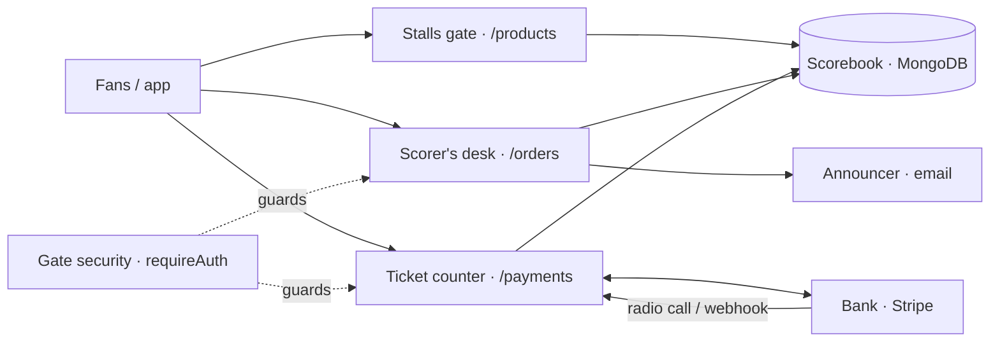
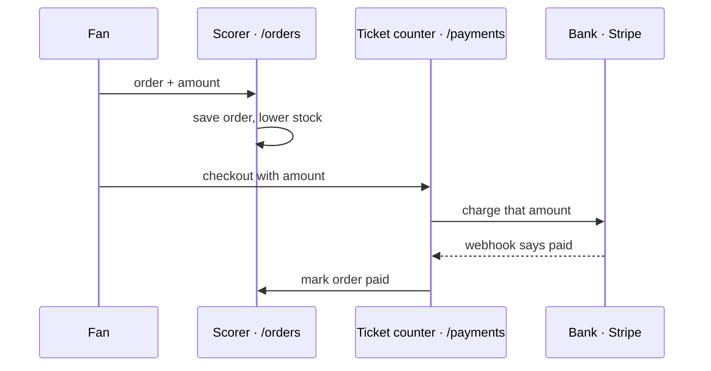
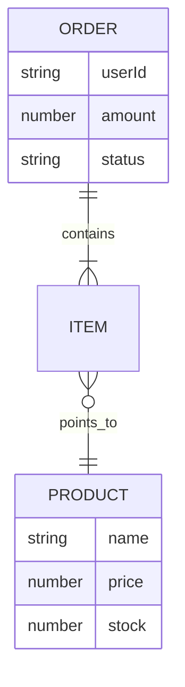

# 🧒 tiny-shop, explained like you're 5
*Theme: **cricket*** · generated 2026-11-06
> **Trust score: 100%**: 32 of 32 claims are backed by real code (checked without AI).

## 📖 The story

Tiny Shop is a cricket stadium where fans buy things. Fans look at the stalls, pick items, and pay at the ticket counter. Most of the stadium is built. But the ticket counter can be tricked, anyone can knock down a stall, and the refund window is an empty room.

> 👉 **In plain words:** This is the server behind a small online shop. It lists products, saves orders and charges cards through Stripe. Three things are dangerous today: anyone can fake a 'payment succeeded' message, customers can choose their own price, and anyone can delete products. Refunds don't exist yet.

<details><summary>🧑‍💻 Teammate version</summary>

Tiny Shop is a small online shop backend: the stalls (products API), the scorer's desk (orders API) and the ticket counter (Stripe payments). The happy path works: list products, place an order, start a Stripe payment. The weak spots: the Stripe webhook trusts anyone, the price comes from the customer, product deletion has no login check, and refunds are an empty function.

</details>
<details><summary>🧠 Senior version</summary>

Express 4 + Mongoose API with three routers (/products, /orders, /payments) and JWT auth middleware. Stripe PaymentIntents are created with a client-supplied amount; the webhook marks orders paid without signature verification; DELETE /products/:id is unauthenticated; /payments/refund is an empty async handler that never responds. No tests, no input validation, secrets hardcoded in two places.

</details>

## 🎭 The cast

| Real part | In cricket it's… | Why |
|---|---|---|
| **The whole app** (`Express server · src/server.js`) | The cricket stadium | One place where everything happens on match day |
| **Routes** (`/products, /orders, /payments`) | The stadium gates | Each gate has a sign and leads to one part of the ground |
| **Products API** (`src/routes/products.js`) | The food and merch stalls | Where fans see what's on offer |
| **Orders API** (`src/routes/orders.js`) | The scorer's desk | Writes down what each fan picked |
| **Payments** (`Stripe · src/routes/payments.js`) | The ticket counter | Real money turns into a confirmed order |
| **Auth** (`JWT · src/middleware/auth.js`) | Security at the gate checking passes | Only fans with a valid pass get in |
| **Database** (`MongoDB via Mongoose · src/models`) | The official scorebook | Every product and order is written down and kept |
| **Email** (`Nodemailer · src/services/email.js`) | The stadium announcer | Tells the fan their order went through |
| **Webhook** (`POST /payments/webhook`) | The radio call from the bank to the scorer | Someone outside tells us 'the payment worked' |
| **Config / secrets** (`process.env + .env.example`) | The dressing-room locker | Where the keys should be kept safely |
| **A bug** | A dropped catch | Something that should have worked, didn't |
| **A security hole** | A gap in the fence | Lets people in who shouldn't be |

## 🗺️ The big picture

Fans walk in through three gates: the stalls, the scorer's desk and the ticket counter. Every gate writes into the same scorebook. The ticket counter talks to the bank, and the bank radios back when money arrives. The announcer shouts out receipts.

<details><summary>🧑‍💻 Teammate version</summary>

src/server.js opens the stadium: it mounts three routers (/products, /orders, /payments) and connects to MongoDB (the scorebook). Orders and payments sit behind the gate security (requireAuth). Payments talk to Stripe (the bank), and Stripe calls back through the webhook radio. Orders ask the announcer (Nodemailer) to send a receipt.

</details>
<details><summary>🧠 Senior version</summary>

Single Express process. server.js mounts routers at /products, /orders and /payments, enables cors() with defaults and express.json(), then connects Mongoose with MONGO_URL before listen(). requireAuth (JWT, hardcoded secret) guards orders and checkout/refund but not product deletion or the webhook. External dependencies: Stripe (PaymentIntents + webhook), SMTP via Nodemailer.

</details>

📎 Proof: [`src/server.js:12-14`](../../fixtures/shop/src/server.js#L12) · [`src/server.js:16`](../../fixtures/shop/src/server.js#L16)



## 🧩 The parts

### Payments · 🟡 Partly built
**The ticket counter** · `src/routes/payments.js`

The ticket counter takes money and asks the bank to charge the fan. But it lets the fan say the price, it believes any radio call that says 'paid', and the refund window has nobody inside.

> 👉 **In plain words:** Card payments go through Stripe. Customers can set their own price, fake 'payment done' messages are accepted, and the refund button does nothing.

<details><summary>🧑‍💻 Teammate version</summary>

Three endpoints: POST /checkout creates a Stripe PaymentIntent, POST /webhook marks an order 'paid' when Stripe says so, and POST /refund is wired to an empty function. Checkout works mechanically, but the amount comes from req.body and the webhook trusts its input.

</details>
<details><summary>🧠 Senior version</summary>

POST /checkout → stripe.paymentIntents.create({ amount: req.body.amount }). POST /webhook parses req.body (already JSON-parsed by express.json()) and calls Order.findByIdAndUpdate(..., {status:'paid'}) with no stripe.webhooks.constructEvent. POST /refund → empty async refundOrder that never sends a response.

</details>

📎 Proof: [`src/routes/payments.js:10-11`](../../fixtures/shop/src/routes/payments.js#L10) · [`src/routes/payments.js:29-31`](../../fixtures/shop/src/routes/payments.js#L29)

### Orders · ✅ Working
**The scorer's desk** · `src/routes/orders.js`

The scorer writes down what a fan picked and takes the items off the stall shelves. Then the announcer sends a receipt. It works, but it trusts the fan about the total and counts shelf items one by one.

> 👉 **In plain words:** Orders are saved and stock is reduced. It works, but the order total comes from the customer, and stock can go below zero.

<details><summary>🧑‍💻 Teammate version</summary>

POST /orders (login required) creates an order with the items and amount from the request, lowers stock for each product one at a time, and fires a receipt email. GET /orders/mine lists your own orders.

</details>
<details><summary>🧠 Senior version</summary>

Order.create with client-supplied amount; per-item Product.findById + save inside a for-loop (N+1, no transaction, no null check, no stock floor); sendReceipt(...).catch(() => {}) swallows email errors. GET /mine filters by req.user.id (correct ownership check).

</details>

📎 Proof: [`src/routes/orders.js:8`](../../fixtures/shop/src/routes/orders.js#L8) · [`src/routes/orders.js:20`](../../fixtures/shop/src/routes/orders.js#L20)

### Products · 🟡 Partly built
**The food and merch stalls** · `src/routes/products.js`

Anyone can look at the stalls, which is good. But anyone can also knock a stall down, without showing a pass.

> 👉 **In plain words:** Anyone can see the products, which is fine. Anyone can also delete products without logging in, which is not.

<details><summary>🧑‍💻 Teammate version</summary>

GET /products lists every product (no paging). DELETE /products/:id deletes a product and is not behind requireAuth. There's no way to create or edit products through the API.

</details>
<details><summary>🧠 Senior version</summary>

GET / → Product.find() unbounded. DELETE /:id → findByIdAndDelete with no auth or role check. No POST/PUT routes, so products must be inserted directly into the DB.

</details>

📎 Proof: [`src/routes/products.js:10-11`](../../fixtures/shop/src/routes/products.js#L10)

### Gate security (auth) · ✅ Working
**Security at the gate checking passes** · `src/middleware/auth.js`

The guard checks each fan's pass. But the secret stamp used to make passes is written on the guard's hat, where anyone who reads the code can copy it.

> 👉 **In plain words:** Login checking works, but the secret used to create login tokens is written in the code, so anyone who sees the code can create fake logins.

<details><summary>🧑‍💻 Teammate version</summary>

requireAuth reads the Bearer token and verifies it with jsonwebtoken. The signing secret is the hardcoded string 'super-secret-jwt-key', so anyone with the code can make valid passes.

</details>
<details><summary>🧠 Senior version</summary>

jwt.verify(token, 'super-secret-jwt-key'): secret in source, no algorithm pinning, no expiry enforcement beyond the token's own claims. There is no login/signup endpoint in this repo, so tokens must be issued elsewhere.

</details>

📎 Proof: [`src/middleware/auth.js:6`](../../fixtures/shop/src/middleware/auth.js#L6)

### Scorebook (data models) · ✅ Working
**The official scorebook** · `src/models`

Two pages in the scorebook: one for things on sale, one for fans' orders.

> 👉 **In plain words:** The database stores two things: products (name, price, stock) and orders (who, what, total, paid or not).

<details><summary>🧑‍💻 Teammate version</summary>

Mongoose models: Product (name, price, stock) and Order (userId, items, amount, status = pending/paid).

</details>
<details><summary>🧠 Senior version</summary>

Product {name, price, stock} and Order {userId, items[{productId, qty}], amount, status default 'pending'}. No validation, no indexes, userId is a plain String (no ref).

</details>

📎 Proof: [`src/models/Order.js:7`](../../fixtures/shop/src/models/Order.js#L7)

### Announcer (email) · ✅ Working
**The stadium announcer** · `src/services/email.js`

The announcer tells fans their order is in. If the microphone breaks, nobody notices.

> 👉 **In plain words:** After an order, a receipt email is sent. If sending fails, nobody is told.

<details><summary>🧑‍💻 Teammate version</summary>

sendReceipt sends a plain-text email through SMTP (Nodemailer). The SMTP settings come from env vars that aren't listed in .env.example.

</details>
<details><summary>🧠 Senior version</summary>

Nodemailer transport from SMTP_HOST/SMTP_USER/SMTP_PASS (undocumented). Caller swallows failures.

</details>

📎 Proof: [`src/services/email.js:4`](../../fixtures/shop/src/services/email.js#L4)

## 🚶 Journeys

### A fan buys something
From picking a snack to the scorer writing 'paid'.
1. The fan shows their pass at the gate. ([`src/middleware/auth.js:4`](../../fixtures/shop/src/middleware/auth.js#L4))
2. The scorer writes the order down. ⚠️ The fan also says how much it costs, and the scorer believes them. ([`src/routes/orders.js:9`](../../fixtures/shop/src/routes/orders.js#L9))
3. Items are taken off the stall shelves, one trip per item. ([`src/routes/orders.js:10-11`](../../fixtures/shop/src/routes/orders.js#L10))
4. At the ticket counter, the bank is asked to charge the price the fan said. ([`src/routes/payments.js:11`](../../fixtures/shop/src/routes/payments.js#L11))
5. The bank radios 'paid!' and the scorer marks the order paid. ⚠️ The scorer never checks it's really the bank on the radio. ([`src/routes/payments.js:22`](../../fixtures/shop/src/routes/payments.js#L22))



### A fan asks for their money back
1. The fan walks to the refund window with their pass. ([`src/routes/payments.js:27`](../../fixtures/shop/src/routes/payments.js#L27))
2. ⚠️ Here the story stops: the room is empty. The fan waits forever and nobody answers. ([`src/routes/payments.js:30`](../../fixtures/shop/src/routes/payments.js#L30))

## 📦 What it remembers

The scorebook has two pages: things on sale, and fans' orders. An order lists items and a total, and starts as 'waiting to pay'.

<details><summary>🧑‍💻 Teammate version</summary>

MongoDB stores Products and Orders. Orders reference products by id string and the user by id string; status goes pending → paid (there is no 'refunded' or 'failed').

</details>
<details><summary>🧠 Senior version</summary>

Two Mongoose collections, no schema validation, no indexes, no references (plain String ids). Status values are only set to 'pending' (default) and 'paid' (webhook).

</details>
- **Product** (A stall item): Something on sale, its price, and how many are left.
- **Order** (A line in the scorebook): Who ordered, what, the total, and if it's paid.



## 🚨 The uncomfortable truth
🔴 Broken: **4** · 🟠 Risky: **5** · 🟡 Unfinished: **0** · 🔵 Cleanup: **3**

| # | Severity | What's wrong | Confidence |
|---|---|---|---|
| 1 | 🔴 Broken | Anyone can fake a 'payment done' message, and the shop marks the order paid | verified |
| 2 | 🔴 Broken | Customers choose their own price, and the shop charges it | verified |
| 3 | 🔴 Broken | Anyone can delete products without logging in | verified |
| 4 | 🔴 Broken | The refund button does nothing, and the app freezes waiting | verified |
| 5 | 🟠 Risky | The login secret is written in the code, so logins can be faked | verified |
| 6 | 🟠 Risky | The Stripe key is written in the code | verified |
| 7 | 🟠 Risky | Stock can go below zero, and big orders are slow | verified |
| 8 | 🟠 Risky | If the receipt email fails, nobody finds out | verified |
| 9 | 🟠 Risky | There are no automated tests, even for payments | verified |
| 10 | 🔵 Cleanup | The product list loads every product at once | verified |
| 11 | 🔵 Cleanup | Email settings are missing from the setup list | verified |
| 12 | 🔵 Cleanup | Any website is allowed to call this server | likely |

### 1. 🔴 Broken: Anyone can fake a 'payment done' message, and the shop marks the order paid
*Stripe webhook does not verify the signature*

When the bank radios 'paid!', the scorer writes 'paid' without checking it's really the bank. Anyone can pretend.

> 👉 **In plain words:** Anyone who sends a fake 'payment succeeded' message to the shop's webhook address gets their order marked as paid without paying.

<details><summary>🧑‍💻 Teammate version</summary>

The webhook reads req.body and marks the order paid. It never checks Stripe's signature header, so anyone who knows the URL can mark any order as paid.

</details>
<details><summary>🧠 Senior version</summary>

No stripe.webhooks.constructEvent(rawBody, sig, secret). express.json() runs globally, so the raw body needed for verification isn't even available on this route.

</details>

**Why it matters:** People can get things for free. *(People can get products for free.)*

**🛠 How to fix:** Mount the webhook with express.raw({type:'application/json'}) before express.json(), verify with stripe.webhooks.constructEvent(req.body, req.headers['stripe-signature'], process.env.STRIPE_WEBHOOK_SECRET), and make the handler idempotent.
📎 Proof: [`src/routes/payments.js:19-20`](../../fixtures/shop/src/routes/payments.js#L19)

### 2. 🔴 Broken: Customers choose their own price, and the shop charges it
*Charge amount is taken from the client request*

The ticket counter asks the fan 'how much should I charge you?' and charges exactly that. A fan can say 1 rupee.

> 👉 **In plain words:** The price charged to the card is whatever number the customer's app sends. Someone can pay ₹1 for a ₹10,000 order.

<details><summary>🧑‍💻 Teammate version</summary>

Both the order total and the Stripe charge use req.body.amount instead of adding up real product prices.

</details>
<details><summary>🧠 Senior version</summary>

Order.amount and PaymentIntent.amount come from req.body; nothing recomputes from Product.price × qty.

</details>

**Why it matters:** Big things can be bought for tiny money. *(The shop loses money on every tampered order.)*

**🛠 How to fix:** Load products by id, compute sum(price*qty) server-side, store it on the Order, and create the PaymentIntent from the stored order amount (accept only orderId from the client).
📎 Proof: [`src/routes/payments.js:11`](../../fixtures/shop/src/routes/payments.js#L11) · [`src/routes/orders.js:9`](../../fixtures/shop/src/routes/orders.js#L9)

### 3. 🔴 Broken: Anyone can delete products without logging in
*DELETE /products/:id has no authentication*

Every other important gate has a guard. The 'remove a stall' gate has none.

> 👉 **In plain words:** Anyone on the internet can delete any product with one request. No login is needed.

<details><summary>🧑‍💻 Teammate version</summary>

The delete route isn't wrapped in requireAuth, and the router isn't mounted behind it either, so anyone can delete products.

</details>
<details><summary>🧠 Senior version</summary>

products router has no auth middleware and is mounted bare at /products in server.js; DELETE /:id calls findByIdAndDelete directly. There are no admin roles anywhere.

</details>

**Why it matters:** Someone could empty the whole shop. *(A stranger could empty the whole catalogue.)*

**🛠 How to fix:** router.delete('/:id', requireAuth, requireRole('admin'), ...); add a role claim to the JWT.
📎 Proof: [`src/routes/products.js:10`](../../fixtures/shop/src/routes/products.js#L10) · [`src/server.js:12`](../../fixtures/shop/src/server.js#L12)

### 4. 🔴 Broken: The refund button does nothing, and the app freezes waiting
*POST /payments/refund is an empty handler that never responds*

There's a refund sign and a door, but nobody inside. The fan just stands and waits.

> 👉 **In plain words:** Asking for a refund does nothing and the request never gets an answer, so the app just keeps loading.

<details><summary>🧑‍💻 Teammate version</summary>

refundOrder only has a TODO comment. It doesn't refund, doesn't update the order, and never sends a reply, so the request hangs.

</details>
<details><summary>🧠 Senior version</summary>

Empty async function bound to a live route; no Stripe refunds.create, no status change, no response → client hangs until timeout.

</details>

**Why it matters:** Fans can't get money back. *(Customers can't get money back, and support must refund by hand in Stripe.)*

**🛠 How to fix:** Check ownership and status, call stripe.refunds.create({ payment_intent }), set status 'refunded', respond 200. Until then, return 501.
📎 Proof: [`src/routes/payments.js:29-31`](../../fixtures/shop/src/routes/payments.js#L29)

### 5. 🟠 Risky: The login secret is written in the code, so logins can be faked
*JWT secret is hardcoded in source*

Passes are made with a secret stamp. The stamp's pattern is written right in the code.

> 👉 **In plain words:** The secret key used to create login tokens is written in the code. Anyone who has seen the code can log in as any user.

<details><summary>🧑‍💻 Teammate version</summary>

jwt.verify uses the literal string 'super-secret-jwt-key'. Anyone with the code can create valid login tokens.

</details>
<details><summary>🧠 Senior version</summary>

Hardcoded HMAC secret; rotate and load from env (JWT_SECRET), pin algorithms: ['HS256'].

</details>

**Why it matters:** Anyone could make a fake pass. *(Anyone with the code can take over any account.)*

**🛠 How to fix:** jwt.verify(token, process.env.JWT_SECRET, { algorithms: ['HS256'] }); document JWT_SECRET in .env.example.
📎 Proof: [`src/middleware/auth.js:6`](../../fixtures/shop/src/middleware/auth.js#L6)

### 6. 🟠 Risky: The Stripe key is written in the code
*Stripe secret key hardcoded in payments.js*

The key to the bank is written in the code instead of being locked in the locker.

> 👉 **In plain words:** The Stripe key (a test key here) is written directly in the code instead of a protected settings file.

<details><summary>🧑‍💻 Teammate version</summary>

The Stripe client is created with a key written in the file (a test key here, value hidden). It should come from an env var.

</details>
<details><summary>🧠 Senior version</summary>

new Stripe('<masked test key>'): move to STRIPE_SECRET_KEY, and rotate the key if this repo was ever public.

</details>

**Why it matters:** If it were a real key, anyone could use the bank. *(If a real key ends up there, anyone who sees the code can use the shop's Stripe account.)*

**🛠 How to fix:** new Stripe(process.env.STRIPE_SECRET_KEY); add it to .env.example; scan history for leaked keys.
📎 Proof: [`src/routes/payments.js:6`](../../fixtures/shop/src/routes/payments.js#L6)

### 7. 🟠 Risky: Stock can go below zero, and big orders are slow
*Stock update is N+1, non-atomic, and unchecked*

For each item, the scorer walks to the shelf, takes one off, and walks back. Two fans at once can grab the last snack, and the shelf can say -1.

> 👉 **In plain words:** Two people can buy the last item at the same time, and stock can go negative. Each item in the cart costs a separate database trip.

<details><summary>🧑‍💻 Teammate version</summary>

Stock is lowered in a loop with one database trip per item, with no check that enough stock exists, and no protection when two orders happen at the same time.

</details>
<details><summary>🧠 Senior version</summary>

findById + save per item: N+1 round trips, a read-modify-write race, no stock >= qty guard, and a TypeError if a productId is unknown (product is null). The order is created before stock is checked.

</details>

**Why it matters:** You can sell snacks you don't have. *(The shop can sell items it doesn't have.)*

**🛠 How to fix:** Product.updateOne({ _id, stock: { $gte: qty } }, { $inc: { stock: -qty } }) or bulkWrite inside a transaction; validate the items before creating the order.
📎 Proof: [`src/routes/orders.js:11-12`](../../fixtures/shop/src/routes/orders.js#L11)

### 8. 🟠 Risky: If the receipt email fails, nobody finds out
*Receipt email errors are silently swallowed*

The receipt is shouted out, but if it fails, the mistake is thrown in the bin.

> 👉 **In plain words:** If the receipt email fails to send, the error is thrown away. No log, no retry.

<details><summary>🧑‍💻 Teammate version</summary>

sendReceipt(...).catch(() => {}) hides every email failure, with no log and no retry.

</details>
<details><summary>🧠 Senior version</summary>

Fire-and-forget with an empty catch; no logging, retry or outbox.

</details>

**Why it matters:** Fans don't get receipts and nobody knows why. *(Customers miss receipts and nobody knows why.)*

**🛠 How to fix:** .catch(err => logger.error({ err, orderId }, 'receipt failed')) or push to a job queue.
📎 Proof: [`src/routes/orders.js:15`](../../fixtures/shop/src/routes/orders.js#L15)

### 9. 🟠 Risky: There are no automated tests, even for payments
*No automated tests, while money is handled*

There's no practice at all. Every match is the first try.

> 👉 **In plain words:** There are no automated tests at all, even for the payment code.

<details><summary>🧑‍💻 Teammate version</summary>

There are no test files and no test script, yet the app takes payments.

</details>
<details><summary>🧠 Senior version</summary>

No test runner in package.json and no test files; payment and stock logic are untested.

</details>

**Why it matters:** Mistakes are found by real fans. *(Any change can break checkout without anyone noticing until customers complain.)*

**🛠 How to fix:** Add vitest/jest + supertest with mongodb-memory-server; cover the webhook, amount calculation and stock decrement.
📎 Proof: [`package.json:6-7`](../../fixtures/shop/package.json#L6)

### 10. 🔵 Cleanup: The product list loads every product at once
*GET /products has no pagination*

To show the stalls, the whole book is read out loud. Fine now, slow later.

> 👉 **In plain words:** The product list loads every product in one go, with no pages.

<details><summary>🧑‍💻 Teammate version</summary>

Product.find() returns every product in one response.

</details>
<details><summary>🧠 Senior version</summary>

Unbounded find(); add limit/skip or cursor pagination plus a projection.

</details>

**Why it matters:** It gets slow when there are many stalls. *(It will get slow as the catalogue grows.)*

**🛠 How to fix:** Product.find().limit(limit).skip(offset).lean()
📎 Proof: [`src/routes/products.js:6`](../../fixtures/shop/src/routes/products.js#L6)

### 11. 🔵 Cleanup: Email settings are missing from the setup list
*SMTP_HOST, SMTP_USER, SMTP_PASS are used but not documented*

The email announcer needs three keys, but the list of keys doesn't mention them.

> 👉 **In plain words:** The email service needs three settings (SMTP_HOST, SMTP_USER, SMTP_PASS) that the setup file doesn't mention.

<details><summary>🧑‍💻 Teammate version</summary>

.env.example only lists MONGO_URL and PORT. The email service also needs SMTP_HOST, SMTP_USER and SMTP_PASS.

</details>
<details><summary>🧠 Senior version</summary>

Undocumented env vars: SMTP_HOST, SMTP_USER, SMTP_PASS (plus the missing STRIPE_SECRET_KEY / JWT_SECRET once fixed).

</details>

**Why it matters:** New helpers can't make the announcer work. *(New developers set the app up and emails silently fail.)*

**🛠 How to fix:** Document all env vars in .env.example and validate them at boot.
📎 Proof: [`src/services/email.js:5`](../../fixtures/shop/src/services/email.js#L5)

### 12. 🔵 Cleanup: Any website is allowed to call this server
*cors() enabled with default (allow-all) settings*

Any website can send messages to this stadium. Usually you only allow your own.

> 👉 **In plain words:** Any website is allowed to send requests to this server. Logins use tokens, not cookies, so the risk is limited.

<details><summary>🧑‍💻 Teammate version</summary>

app.use(cors()) allows requests from any origin. Since auth uses Bearer tokens (not cookies), the risk is moderate.

</details>
<details><summary>🧠 Senior version</summary>

Default cors() → Access-Control-Allow-Origin: *. Lower risk with header tokens; restrict it to known origins anyway.

</details>

**Why it matters:** Strangers' websites can poke the stadium. *(Wider exposure than needed.)*

**🛠 How to fix:** cors({ origin: process.env.CORS_ORIGINS.split(',') })
📎 Proof: [`src/server.js:9`](../../fixtures/shop/src/server.js#L9)

## 🤝 Handover notes

Whoever built this stopped while building the refund window. The ticket counter needs its locks fixed before real fans arrive.

<details><summary>🧑‍💻 Teammate version</summary>

There's no project history available, but the code shows the last unfinished job: refunds (an empty handler with a TODO). Before going live: fix the webhook verification, compute prices on the server, and protect product deletion.

</details>
<details><summary>🧠 Senior version</summary>

History unavailable (scanned with --no-git). Code signals: an empty refund handler with a TODO, no product create/update endpoints, no login/signup (JWTs are issued elsewhere). Priority order: F1, F2, F3, F4, then F5–F7.

</details>

**Work left half-way:**
- **Refunds**: The refund window was being built but is still empty. 📎 Proof: [`src/routes/payments.js:30`](../../fixtures/shop/src/routes/payments.js#L30)
- **Managing products**: You can remove stalls but not add or change them. 📎 Proof: [`src/routes/products.js:5`](../../fixtures/shop/src/routes/products.js#L5)

## ▶️ How to run it
1. Get the stadium's tools.
   ```
   npm install
   ```
2. Fill in the locker with keys.
   ```
   cp .env.example .env
   ```
3. Open the scorebook (start MongoDB).
   ```
   docker run -d -p 27017:27017 mongo:7
   ```
4. Open the gates!
   ```
   npm run dev
   ```

**Missing or unclear:**
- SMTP_HOST, SMTP_USER and SMTP_PASS are needed but not listed in .env.example
- There's no way to create products through the API: you have to seed MongoDB by hand
- There's no login endpoint: you need a JWT signed with the hardcoded secret to call protected routes
- Stripe webhook setup (endpoint + signing secret) isn't documented

## 📚 Glossary

| Word | In cricket words | What it really is |
|---|---|---|
| **API** | The stadium gates and the people behind them | The set of URLs the app answers |
| **Route** | One gate with a sign on it | A URL + method, like POST /orders |
| **JWT** | A fan's stamped pass | A signed token that proves who you are |
| **Middleware** | The guard standing at a gate | Code that runs before a route, like requireAuth |
| **MongoDB** | The official scorebook | The database where products and orders are stored |
| **Stripe** | The bank behind the ticket counter | The payment provider |
| **PaymentIntent** | Asking the bank 'please charge this fan' | A Stripe object representing one payment attempt |
| **Webhook** | The bank's radio call to the scorer | An HTTP call Stripe makes to us when something happens |
| **N+1 query** | Walking to the shelf once per item | One database query per item inside a loop |
| **Environment variable** | A key kept in the locker | A setting given to the app from outside the code |

## ❓ Questions people ask

**Can this take real payments today?**

Not safely. The counter can be tricked about the price and about whether someone paid.

📎 Proof: [`src/routes/payments.js:20`](../../fixtures/shop/src/routes/payments.js#L20)

**What should I fix first?**

The ticket counter locks, then the guard on the stall gate, then the refund room.

**Where would I add a new kind of thing to sell?**

In the scorebook page for stall items.

📎 Proof: [`src/models/Product.js:3`](../../fixtures/shop/src/models/Product.js#L3)

---
*Made with ELI5 Repo. Every 📎 link points at the exact code behind a claim.*
